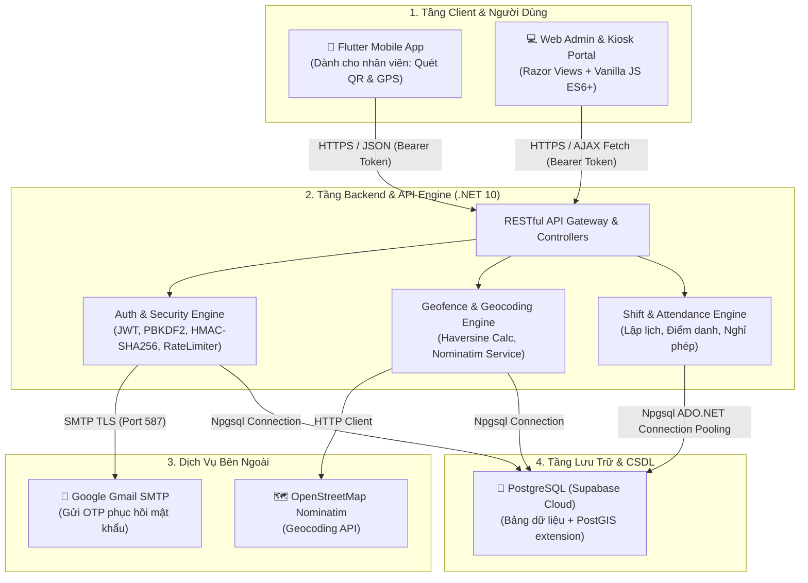

# BÁO CÁO CHI TIẾT CÔNG NGHỆ & KIẾN TRÚC KỸ THUẬT HỆ THỐNG MANAGE365 (RETAIL365)

> **Dự án:** Retail365 / Manage365  
> **Phiên bản tài liệu:** 1.0  
> **Ngày lập:** 25/10/2026  
> **Mục đích:** Tổng hợp đầy đủ, chi tiết toàn bộ các công nghệ, ngôn ngữ, thư viện, dịch vụ đám mây, kiến trúc và giải pháp bảo mật được áp dụng trong hệ sinh thái Manage365.

---

## 1. TỔNG QUAN KIẾN TRÚC HỆ THỐNG

Dự án **Manage365 (Retail365)** là giải pháp toàn diện phục vụ quản lý chuỗi bán lẻ, điều phối nhân sự, phân ca linh động và điểm danh/chấm công đa tầng chống gian lận. Hệ thống được tổ chức theo mô hình phân tầng dịch vụ (Multi-tiered Architecture) kết hợp giữa Web Admin & Backend RESTful API và Ứng dụng di động.

---

## 2. BACKEND & WEB API (.NET 10)

Backend của Manage365 được xây dựng trên nền tảng .NET mới nhất, ưu tiên hiệu năng cao, kiểm soát chặt chẽ bộ nhớ và độ trễ thấp.

### 2.1 Nền tảng cốt lõi
* **Framework:** **.NET 10.0** (`net10.0`), ASP.NET Core Web API kết hợp MVC Razor Views.
* **Ngôn ngữ lập trình:** **C# 13** với các tính năng hiện đại: Nullable reference types, Pattern matching, Implicit Usings, Minimal API routing song song với Controller routing.
* **Kiến trúc phần mềm:**
  * **Repository Pattern:** Tách biệt rõ ràng logic truy cập dữ liệu ([`IUserRepository`](file:///C:/Users/boomh/OneDrive/Documents/manage365/Repositories/Users/IUserRepository.cs), [`IShiftSchedulingRepository`](file:///C:/Users/boomh/OneDrive/Documents/manage365/Repositories/Shifts/IShiftSchedulingRepository.cs), [`ILeaveRequestRepository`](file:///C:/Users/boomh/OneDrive/Documents/manage365/Repositories/LeaveRequests/ILeaveRequestRepository.cs)).
  * **Dependency Injection (DI):** Đăng ký dịch vụ tường minh theo vòng đời (`Scoped`, `Singleton`), cấu hình định kiểu mạnh thông qua `IOptions<T>` với validation khi khởi động (`ValidateOnStart()`).
  * **Global Exception Handling:** Xử lý lỗi tập trung theo chuẩn **RFC 7807** (`ProblemDetails`) qua [`ApiExceptionHandler`](file:///C:/Users/boomh/OneDrive/Documents/manage365/Routes/API/Errors/ApiExceptionHandler.cs).

### 2.2 Các gói thư viện NuGet chính
| Gói thư viện (Package) | Phiên bản | Vai trò & Mục đích sử dụng |
| :--- | :---: | :--- |
| `Microsoft.AspNetCore.Authentication.JwtBearer` | `10.0.12` | Xác thực người dùng qua Bearer Token, kiểm tra chữ ký khóa đối xứng (Symmetric Security Key), thẩm định Issuer/Audience và phân quyền theo Claims. |
| `Npgsql` | `10.0.3` | Driver ADO.NET chính thức hiệu năng cao cho PostgreSQL, hỗ trợ kết nối `NpgsqlDataSource` và Connection Pooling tối ưu. |
| `Lyntai.Storage.Postgres` | `3.5.1` | Thư viện hỗ trợ quản lý kết nối và tiện ích truy vấn dữ liệu PostgreSQL. |
| `Swashbuckle.AspNetCore` | `10.2.3` | Sinh tự động tài liệu kỹ thuật chuẩn OpenAPI / Swagger UI, hỗ trợ kiểm thử trực tiếp các endpoint API kèm cấu hình bảo mật Bearer JWT. |
| `Microsoft.VisualStudio.Azure.Containers.Tools.Targets` | `1.23.0` | Công cụ tích hợp Visual Studio phục vụ build và debug container Docker. |

---

## 3. CƠ CHẾ BẢO MẬT & THUẬT TOÁN CHỐNG GIAN LẬN

Hệ thống được thiết kế nhiều lớp bảo mật nhằm bảo vệ dữ liệu và đặc biệt là ngăn chặn gian lận chấm công:

### 3.1 Băm mật khẩu (Password Hashing)
* **Thuật toán:** **PBKDF2** (Password-Based Key Derivation Function 2) với thuật toán HMAC-SHA256.
* **Thông số an toàn:** Salt 128-bit ngẫu nhiên và **100.000 vòng lặp (iterations)**, chống hoàn toàn kỹ thuật tấn công Rainbow Table và Brute-force mật khẩu.

### 3.2 Chấm công bằng Mã QR Động (Dynamic QR Anti-Fraud)
* **Ký số thời gian thực:** Mỗi mã QR được sinh bởi Kiosk mang payload chứa `storeCode`, `timestamp`, `nonce` ngẫu nhiên và chữ ký số **HMAC-SHA256** được ký bằng khóa bí mật phía máy chủ (`QrHmacSecret`).
* **Thời hạn hiệu lực siêu ngắn (TTL):** Mã QR tự động hết hạn và thay mới sau **30 - 35 giây**. Hành vi chụp ảnh mã QR gửi cho người khác chấm công hộ sẽ bị vô hiệu hóa vì mã sẽ hết hạn trước khi kịp sử dụng.

### 3.3 Hàng rào địa lý GPS (Geofencing & Anti-Fake GPS)
* **Xác thực vị trí 2 chiều:**
  1. Tính khoảng cách thực tế giữa vị trí nhân viên và tâm cửa hàng dựa trên công thức **Haversine Formula** hoặc hàm không gian **PostGIS** (`ST_Distance`).
  2. Bán kính cho phép cấu hình theo từng cửa hàng (mặc định 50m – 100m).
* **Kiểm định dữ liệu GPS:**
  * Sai số định vị bắt buộc: `MaxLocationAccuracyMeters <= 30m`.
  * Độ trễ dữ liệu GPS: `MaxLocationAgeSeconds <= 60s` (loại bỏ dữ liệu vị trí cũ được lưu tạm).
  * Phát hiện Fake GPS: Kiểm tra cờ thiết bị `isMocked == false`.

### 3.4 Bảo vệ chống Brute-force & Dò quét (Rate Limiting)
* Tích hợp sẵn middleware `Microsoft.AspNetCore.RateLimiting` của ASP.NET Core: Giới hạn tần suất gọi API (VD: tối đa 5 yêu cầu/phút trên mỗi địa chỉ IP đối với các endpoint nhạy cảm như Đăng nhập và Yêu cầu khôi phục mật khẩu).
* Phản hồi mã lỗi chuẩn `429 Too Many Requests` kèm tiêu đề `Retry-After`.

### 3.5 Khôi phục mật khẩu an toàn (OTP Flow)
* Mã OTP 6 chữ số có hiệu lực trong 10 phút, lưu trữ dưới dạng băm.
* Giới hạn tối đa 5 lần nhập sai. Sau khi xác thực thành công, hệ thống cấp phát một `Reset Token` tạm thời mã hóa bằng **ASP.NET Core Data Protection** với thời hạn 5 phút.

---

## 4. TẦNG CƠ SỞ DỮ LIỆU (DATABASE & STORAGE)

* **Hệ quản trị CSDL:** **PostgreSQL** chạy trên nền tảng đám mây **Supabase** (vùng AWS Seoul `ap-northeast-2`).
* **Phương thức kết nối:** Kết nối trực tiếp qua Connection Pooler của Supabase (cổng 5432 / 6543) bằng `NpgsqlDataSource`.
* **Tiện ích mở rộng (Extensions):**
  * `postgis`: Hỗ trợ lưu trữ kiểu dữ liệu tọa độ không gian địa lý (`GEOMETRY`, `POINT`) và các hàm tính khoảng cách địa lý.
  * `uuid-ossp` / `pgcrypto`: Sinh khóa chính dạng GUID/UUID ngẫu nhiên.
* **Cơ chế quản lý Schema:** Hệ thống quản lý cấu trúc bảng và di chuyển dữ liệu (Migrations) thông qua các kịch bản SQL nguyên bản lưu trữ tại thư mục [`database/`](file:///C:/Users/boomh/OneDrive/Documents/manage365/database/):
  * `20260927_create_password_reset_codes.sql`
  * `20261009_create_departments_and_tools.sql`
  * `20261009_create_permissions_tables.sql`
  * `20261009_create_user_refresh_tokens.sql`
  * `20261010_create_flexible_shift_tables.sql`
  * `20261022_create_leave_requests_tables.sql`
  * `20261023_create_notifications.sql`

---

## 5. TẦNG GIAO DIỆN WEB (FRONTEND WEB ADMIN & KIOSK)

Giao diện Web Admin và Màn hình trạm Kiosk được thiết kế tối ưu, tải nhanh và không phụ thuộc vào các thư viện framework cồng kềnh:

* **Công nghệ Render:** **ASP.NET Core Razor MVC** (`.cshtml`) phục vụ khung hiển thị máy chủ kết hợp tải dữ liệu động qua **AJAX / Fetch API** phía Client:
  * [`Views/Home/Index.cshtml`](file:///C:/Users/boomh/OneDrive/Documents/manage365/Views/Home/Index.cshtml): Màn hình trạm Kiosk hiển thị mã QR thời gian thực và Dashboard điểm danh.
  * [`Views/Home/Schedule.cshtml`](file:///C:/Users/boomh/OneDrive/Documents/manage365/Views/Home/Schedule.cshtml): Bảng điều phối nhân sự, phân ca làm việc theo tuần, in lịch làm việc.
  * [`Views/Home/LeaveRequests.cshtml`](file:///C:/Users/boomh/OneDrive/Documents/manage365/Views/Home/LeaveRequests.cshtml): Hệ thống duyệt đơn nghỉ phép.
  * [`Views/Account/Login.cshtml`](file:///C:/Users/boomh/OneDrive/Documents/manage365/Views/Account/Login.cshtml): Cổng đăng nhập phân quyền cho Quản lý / Thu ngân.
* **CSS & Thiết kế UI:**
  * **Bootstrap 5.3:** Hệ thống lưới (Grid system), Modal popup, Form controls và Responsive layout.
  * **Font Awesome 6.5:** Bộ biểu tượng hiển thị trực quan (Store, Clock, Location, User, Calendar).
  * CSS Modules tùy biến: [`retail365.css`](file:///C:/Users/boomh/OneDrive/Documents/manage365/wwwroot/css/retail365.css), [`app-header.css`](file:///C:/Users/boomh/OneDrive/Documents/manage365/wwwroot/css/app-header.css), [`schedule.css`](file:///C:/Users/boomh/OneDrive/Documents/manage365/wwwroot/css/schedule.css).
* **JavaScript:**
  * Viết bằng **Vanilla JavaScript (ES6+)** hiện đại, sử dụng `async/await`, `document.addEventListener`, DOM manipulation.
  * Cơ chế tự động đếm ngược (Countdown Timer) và tự động gọi API làm mới QR khi hết hạn.
  * Lưu trữ trạng thái phiên đăng nhập qua `localStorage` và `sessionStorage`.
* **Thư viện hiển thị QR:**
  * **`qrcode.js`** (`qrcodejs/1.0.0`): Thư viện Client-side nhẹ giúp vẽ mã QR trực tiếp lên thẻ `<canvas>` hoặc `
` SVG mà không cần gọi dịch vụ bên thứ ba.

---

## 6. DỊCH VỤ TÍCH HỢP BÊN NGOÀI (EXTERNAL INTEGRATIONS)

1. **Dịch vụ Geocoding & Bản đồ (OpenStreetMap Nominatim):**
   * **Endpoint:** `https://nominatim.openstreetmap.org/search`
   * **Mục đích:** Hỗ trợ Quản trị viên nhập địa chỉ cửa hàng bằng chữ thường (VD: *"135 Nguyễn Huệ, Quận 1, TP.HCM"*), dịch vụ sẽ tự động phân giải thành tọa độ GPS (Latitude, Longitude) chính xác để thiết lập tâm Geofence.
   * **Cài đặt:** Tích hợp qua [`NominatimGeocodingService`](file:///C:/Users/boomh/OneDrive/Documents/manage365/Program.cs#L67) sử dụng `HttpClient` có gắn định danh `User-Agent` tuân thủ chính sách sử dụng của Nominatim.
2. **Dịch vụ Thư điện tử (Google Gmail SMTP):**
   * **Host:** `smtp.gmail.com` (Port 587, giao thức TLS/SSL).
   * **Mục đích:** Gửi mã xác thực OTP 6 số bằng template HTML qua email cá nhân của nhân viên khi quên mật khẩu.
   * **Thư viện:** `System.Net.Mail` chuẩn kết hợp cấu hình Gmail App Password.

---

## 7. KIỂM THỬ TỰ ĐỘNG (AUTOMATED TESTING & QA)

Dự án được xây dựng kèm bộ kiểm thử tự động hóa tại project [`manage365.Tests`](file:///C:/Users/boomh/OneDrive/Documents/manage365/manage365.Tests/manage365.Tests.csproj):

* **Framework kiểm thử:** **xUnit v3** (`xunit.v3` 3.2.2) & **xUnit Runner Visual Studio** (`3.1.5`).
* **Test SDK:** `Microsoft.NET.Test.Sdk` (`18.0.1`).
* **Đo lường độ bao phủ mã nguồn (Code Coverage):** `coverlet.collector` (`6.0.4`).
* **Các phạm vi kiểm thử chính:**
  * Kiểm thử đơn vị thuật toán: `AttendanceGeofenceServiceTests.cs`, `PasswordResetServiceTests.cs`.
  * Kiểm thử tính toàn vẹn API & Tag Security: `ApiTagSecurityTests.cs`, `ShiftSchedulingHttpTests.cs`.
  * Kiểm thử tương tác cơ sở dữ liệu: `ShiftSchedulingDatabaseTests.cs`, `LeaveRequestsDatabaseTests.cs`.
  * Kiểm thử vòng đời Token & Phân quyền: `AuthRefreshTokenTests.cs`, `PermissionsControllerTests.cs`.

---

## 8. ĐÓNG GÓI & TRIỂN KHAI (DEVOPS & CONTAINERIZATION)

* **Docker Multi-Stage Build ([`Dockerfile`](file:///C:/Users/boomh/OneDrive/Documents/manage365/Dockerfile)):**
  * Stage 1 (`base`): Sử dụng image runtime tinh gọn `mcr.microsoft.com/dotnet/aspnet:10.0`. Chạy dưới quyền bảo mật non-root user (`$APP_UID`).
  * Stage 2 (`build` / `publish`): Sử dụng image SDK đầy đủ `mcr.microsoft.com/dotnet/sdk:10.0` để biên dịch mã nguồn và tối ưu hóa file nhị phân phát hành.
  * Image cuối cùng siêu nhẹ, sẵn sàng chạy trên Linux/Alpine containers.
* **Điều phối dịch vụ ([`docker-compose.yml`](file:///C:/Users/boomh/OneDrive/Documents/manage365/docker-compose.yml)):**
  * Thiết lập cổng mapping `5000:8080`.
  * Đọc biến môi trường tự động từ tệp [`.env`](file:///C:/Users/boomh/OneDrive/Documents/manage365/.env).
  * Thiết lập môi trường sản xuất hoặc phát triển (`ASPNETCORE_ENVIRONMENT`).

---

## 9. HỆ SINH THÁI MOBILE ĐỒNG HÀNH (FLUTTER APP COMPANION)

Để hoàn thiện quy trình điểm danh khép kín, hệ thống kết nối với ứng dụng di động dành cho nhân viên:

* **Nền tảng:** **Flutter** (Dart SDK).
* **Các thư viện di động chính:**
  * `mobile_scanner`: Điều khiển Camera quét mã QR Kiosk siêu tốc.
  * `geolocator`: Đọc tọa độ GPS phần cứng, kiểm tra độ chính xác và phát hiện giả lập vị trí.
  * `http`: Thực hiện các cuộc gọi RESTful API có xác thực JWT Bearer.
  * `shared_preferences`: Lưu trữ an toàn phiên làm việc và Token trên thiết bị người dùng.

---

## 10. MA TRẬN TỔNG HỢP CÔNG NGHỆ (TECH STACK MATRIX)

| Phân hệ / Tầng | Công nghệ / Thư viện | Phiên bản | Mục đích & Trách nhiệm chính |
| :--- | :--- | :---: | :--- |
| **Backend Runtime** | .NET (C#) | `10.0` | Nền tảng thực thi chính của Web API & Admin |
| **Web Framework** | ASP.NET Core | `10.0` | Routing, Dependency Injection, Middleware, Razor MVC |
| **Database** | PostgreSQL (Supabase) | `15+` | Lưu trữ dữ liệu quan hệ và mở rộng PostGIS |
| **Database Driver** | Npgsql | `10.0.3` | Driver ADO.NET kết nối PostgreSQL hiệu năng cao |
| **API Docs** | Swashbuckle (Swagger) | `10.2.3` | Sinh giao diện kiểm thử và tài liệu OpenAPI |
| **Xác thực** | JWT Bearer Authentication | `10.0.12` | Cấp phát và thẩm định phiên làm việc người dùng |
| **Băm mật khẩu** | PBKDF2 (HMAC-SHA256) | Built-in | Băm mật khẩu an toàn với 100.000 iterations |
| **Ký số QR** | HMAC-SHA256 | Built-in | Sinh chữ ký số bảo mật cho mã QR Kiosk |
| **Kiểm soát tần suất** | ASP.NET Core RateLimiter | `10.0` | Ngăn chặn Brute-force và DDoS |
| **Bản đồ / Tọa độ** | OpenStreetMap Nominatim | REST API | Chuyển đổi địa chỉ cửa hàng sang tọa độ GPS |
| **Email OTP** | Google Gmail SMTP | Port 587 | Gửi mã xác minh 6 số khi quên mật khẩu |
| **Frontend UI** | Bootstrap | `5.3.2` | Hệ thống lưới responsive và giao diện chuẩn |
| **Icon set** | Font Awesome | `6.5.1` | Biểu tượng chức năng |
| **Frontend JS** | Vanilla JavaScript (ES6+) | Chuẩn ES6 | Xử lý logic Kiosk, gọi AJAX, quản lý DOM |
| **QR Client** | qrcode.js | `1.0.0` | Render mã QR trực tiếp trên màn hình Kiosk |
| **Testing** | xUnit.net | `3.2.2` | Bộ kiểm thử đơn vị và tích hợp tự động |
| **Code Coverage** | Coverlet Collector | `6.0.4` | Đo lường độ bao phủ kiểm thử mã nguồn |
| **Đóng gói** | Docker & Docker Compose | Latest | Đóng gói container Linux phục vụ triển khai đa nền tảng |
| **Mobile Client** | Flutter (Dart) | `3.x` | Ứng dụng di động dành cho nhân viên chấm công |
